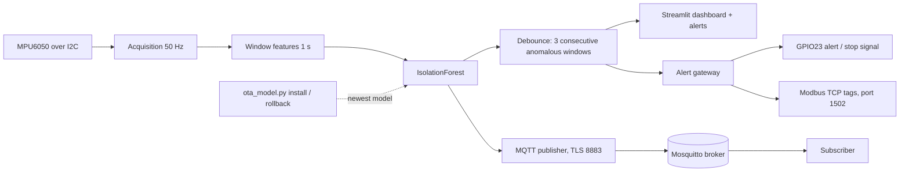

# Architecture

Status: every box has run on the Pi except live sensor-to-gateway wiring (the gateway was tested by replaying recorded windows) and a physical PLC/relay (none attached). See `docs/MILESTONE_CHECKLIST.md`.
